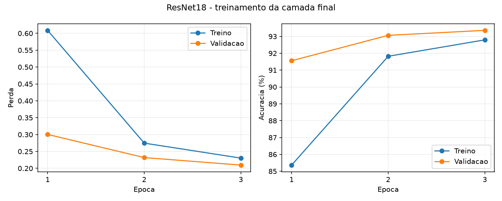

# Etapa 3 - Treinamento inicial

Nesta etapa foi usada a ResNet18 com os pesos do ImageNet. A camada final foi substituida por uma camada com 10 saidas, uma para cada classe do EuroSAT RGB.

Somente os pesos e o bias da camada final sao treinados. As outras camadas e as estatisticas de BatchNorm ficam congeladas.

## Arquivos

- `src/modelo.py`: prepara a ResNet18.
- `src/treinamento.py`: executa treino, validacao e salvamento.
- `docs/resultados_treinamento_inicial.json`: configuracoes e historico da execucao.

## Executar

Na raiz do projeto, com as dependencias instaladas:

```bash
python -c "from notebooks.dataset_py import baixar_dataset; baixar_dataset()"
python -m src.treinamento --num-workers 2
```

Para executar sem processos extras, use `--num-workers 0`. A primeira execucao do modelo baixa os pesos pre-treinados.

## Configuracoes

- Treino: 18.900 imagens.
- Validacao: 4.050 imagens.
- Divisao fixa: `docs/data_split.json`.
- Imagens: 224 x 224, usando o preparo da etapa 2.
- Epocas: 3.
- Lote: 64 imagens.
- Otimizador: Adam.
- Taxa de aprendizado: 0.001.
- Funcao de perda: CrossEntropyLoss.
- Semente: 42.

O melhor modelo e escolhido pela maior acuracia de validacao. Em caso de empate, fica a primeira epoca. O conjunto de teste nao e usado nesta etapa.

Foram usadas 3 epocas para manter o experimento inicial curto em CPU. Esse numero nao foi escolhido por uma busca de hiperparametros.

A acuracia de treino e medida durante as atualizacoes e com variacoes nas imagens. A validacao usa o modelo ao fim da epoca e imagens sem essas variacoes, por isso sua acuracia pode ser maior.

Os parametros podem ser alterados pela linha de comando. Por exemplo:

```bash
python -m src.treinamento --epocas 3 --batch-size 64 --taxa-aprendizado 0.001 --num-workers 2
```

## Modelo salvo

Os arquivos ficam em `outputs/treinamento_inicial/`:

- `melhor_modelo.pth`: pesos do melhor modelo, epoca, classes e configuracoes.
- `resultados.json`: metricas de cada epoca e configuracoes da execucao.

Os pesos ficam fora do Git. Para outro integrante usar o modelo ja treinado, e preciso compartilhar o arquivo `.pth` separadamente.

Para carregar:

```python
import torch
from src.modelo import criar_modelo

salvo = torch.load(
    "outputs/treinamento_inicial/melhor_modelo.pth",
    map_location="cpu",
    weights_only=True,
)
modelo = criar_modelo(num_classes=len(salvo["classes"]))
modelo.load_state_dict(salvo["modelo"])
modelo.eval()
```

## Continuacao na etapa 4

O ajuste fino ainda nao foi implementado. A proxima etapa pode reutilizar `criar_modelo()` e `executar_epoca()`.

Ao liberar o ultimo bloco, o otimizador precisa receber todos os parametros liberados. Em `executar_epoca()`, o argumento `base_congelada=False` permite usar o modo de treino da rede. Na validacao, basta chamar sem otimizador.

Usar a mesma divisao, preparo das imagens e metricas. Registrar se o ajuste fino parte dos pesos do ImageNet ou do modelo desta etapa, alem do numero de epocas e da taxa de aprendizado.

## Resultados

Execucao em CPU no Windows, em 22/11/2026.

| Epoca | Perda treino | Acuracia treino | Perda validacao | Acuracia validacao |
| --- | --- | --- | --- | --- |
| 1 | 0.6087 | 85.37% | 0.3004 | 91.56% |
| 2 | 0.2746 | 91.82% | 0.2318 | 93.06% |
| 3 | 0.2303 | 92.79% | 0.2095 | 93.36% |

Melhor epoca: 3, com 93.36% de acuracia na validacao. O treino e a validacao levaram cerca de 13.7 minutos no total.



A perda diminuiu e a acuracia aumentou nas tres epocas. Esse e o resultado de referencia do treinamento da camada final. Ainda falta comparar com o ajuste fino e avaliar os modelos no conjunto de teste.
