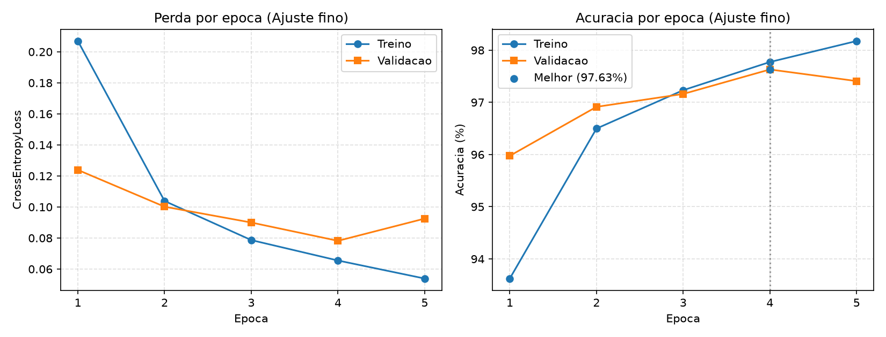

# Etapa 4 - Ajuste fino

Nesta etapa foi reutilizada a estrutura da Etapa 3 com a ResNet18 adaptada para as 10 classes da EuroSAT RGB, descongelando tambem o ultimo bloco convolucional (`layer4`) alem da camada final (`fc`).

As camadas iniciais (`conv1`, `bn1`, `layer1`, `layer2` e `layer3`) e suas estatisticas de BatchNorm permaneceram congeladas para preservar os filtros genericos aprendidos no ImageNet, enquanto `layer4` e `fc` foram ajustados a partir do melhor checkpoint da Etapa 3 (*warm start*) com taxa de aprendizado menor (`0.0001`).

## Arquivos

- `src/treinamento.py`: extensao retrocompativel de `executar_epoca()` com o parametro opcional `camadas_treino`, mantendo as camadas congeladas em modo `.eval()`.
- `src/ajuste_fino.py`: prepara o modelo para ajuste fino, executa treino e validacao, salva pesos/metricas e gera o grafico de curvas.
- `tests/test_ajuste_fino.py`: testes automatizados de congelamento seletivo, protecao de BatchNorm, *warm start* e salvamento.
- `docs/resultados_ajuste_fino.json`: configuracoes e historico oficial da execucao.
- `docs/figuras/ajuste_fino.png`: curvas de perda e acuracia de treino e validacao.

## Executar

Na raiz do projeto, com as dependencias instaladas, a base baixada e o checkpoint da Etapa 3 disponivel em `outputs/treinamento_inicial/melhor_modelo.pth`:

```bash
python -m src.ajuste_fino --modelo-inicial outputs/treinamento_inicial/melhor_modelo.pth --epocas 5 --taxa-aprendizado 0.0001 --num-workers 0
```

Tambem e possivel executar partindo diretamente dos pesos do ImageNet (sem *warm start*) omitindo o argumento `--modelo-inicial`.

## Configuracoes

- Divisao fixa: `docs/data_split.json` (`sha256: b3817b3802fff966378fcc01f618fa495ec0a6bd6548824d671e94c0fb07ea9a`), com 18.900 imagens de treino e 4.050 de validacao (conjunto de teste nao utilizado).
- Imagens: 224 x 224, mesmo pre-processamento da Etapa 2.
- Camadas treinadas: `layer4` e `fc` (8.398.858 parametros treinaveis de 11.181.642 no total, equivalente a 75,11% da rede).
- Origem dos pesos: *warm start* a partir do melhor checkpoint da Etapa 3 (epoca 3, acuracia de validacao inicial de 93,31%, `sha256: 4d2b2ebc3eb8630fdc0168703874ac85f32d8fa08481510b45edb628e818a591`).
- Epocas: 5.
- Lote: 64 imagens.
- Otimizador: Adam.
- Taxa de aprendizado: `0.0001`.
- Funcao de perda: CrossEntropyLoss.
- Semente: 42.
- Ambiente: CPU no Windows (8 threads, PyTorch `2.15.0+cpu`).

O melhor modelo e escolhido exclusivamente pela maior acuracia de validacao (em caso de empate, mantem-se a primeira epoca). O conjunto de teste permanece reservado para a Etapa 5.

## Modelo salvo e uso na Etapa 5

Os arquivos ficam em `outputs/ajuste_fino/`:

- `melhor_modelo.pth`: pesos da melhor epoca (epoca 4), epoca, metricas de validacao, classes e configuracoes (mesmo formato da Etapa 3).
- `resultados.json`: metricas por epoca e configuracoes da execucao (copiado tambem para `docs/resultados_ajuste_fino.json`).

Os pesos `.pth` ficam fora do Git e devem ser compartilhados separadamente com o responsavel pela Etapa 5. O carregamento segue exatamente a mesma rotina da Etapa 3:

```python
import torch
from src.modelo import criar_modelo

salvo = torch.load(
    "outputs/ajuste_fino/melhor_modelo.pth",
    map_location="cpu",
    weights_only=True,
)
modelo = criar_modelo(num_classes=len(salvo["classes"]))
modelo.load_state_dict(salvo["modelo"])
modelo.eval()
```

## Resultados

Execucao em CPU no Windows, em 22/11/2026 (tempo total aproximado de 67,5 minutos).

| Epoca | Perda treino | Acuracia treino | Perda validacao | Acuracia validacao | Tempo (min) |
| --- | --- | --- | --- | --- | --- |
| 1 | 0.2069 | 93.62% | 0.1239 | 95.98% | 10.6 |
| 2 | 0.1038 | 96.50% | 0.1002 | 96.91% | 14.8 |
| 3 | 0.0787 | 97.23% | 0.0900 | 97.16% | 15.1 |
| 4 | 0.0655 | 97.77% | 0.0782 | 97.63% | 14.2 |
| 5 | 0.0539 | 98.17% | 0.0925 | 97.41% | 12.9 |

Melhor epoca: **4**, com **97,63%** de acuracia na validacao e perda de validacao de **0,0782**.



## Analise breve

- **Ganho imediato na 1a epoca:** partindo da camada final ja ajustada na Etapa 3 (93,31%), a liberacao do `layer4` elevou a acuracia de validacao para 95,98% logo na primeira epoca, mostrando que adaptar os filtros profundos ao dominio de imagens de satelite traz ganho expressivo.
- **Reducao consistente de erros:** na melhor epoca (epoca 4, 97,63%), o ganho foi de +4,32 pontos percentuais sobre o checkpoint inicial (+4,27 p.p. em relacao aos 93,36% registrados na Etapa 3), reduzindo os erros na validacao de 271 para 96 imagens em 4.050 (queda relativa de 64,6%).
- **Inicio de sobreajuste controlado na epoca 5:** na ultima epoca, a perda de treino continuou caindo (0,0655 para 0,0539), enquanto a perda de validacao subiu (0,0782 para 0,0925) e a acuracia recuou para 97,41%. O criterio de salvamento pela validacao descartou essa regressao e preservou o checkpoint da epoca 4.