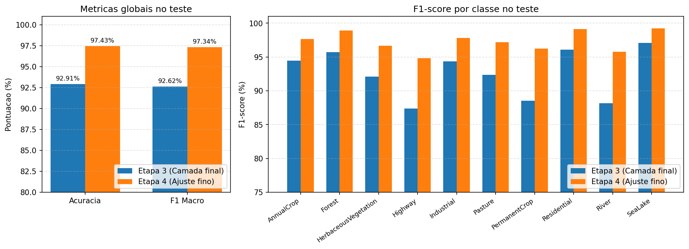
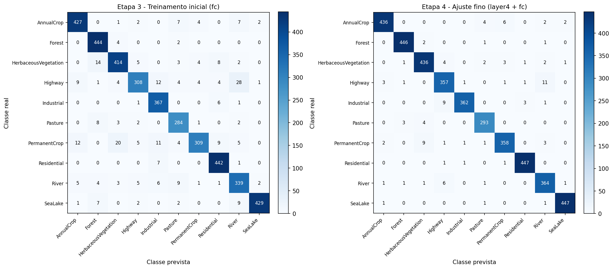
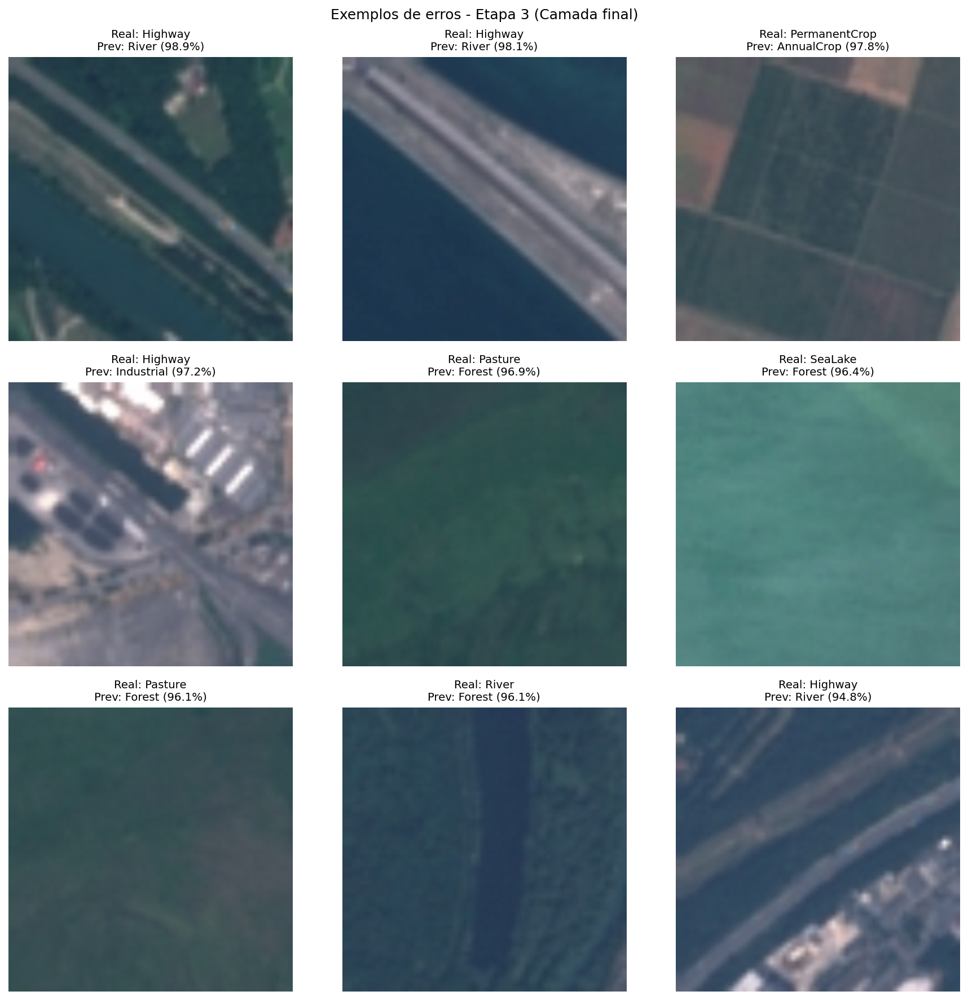
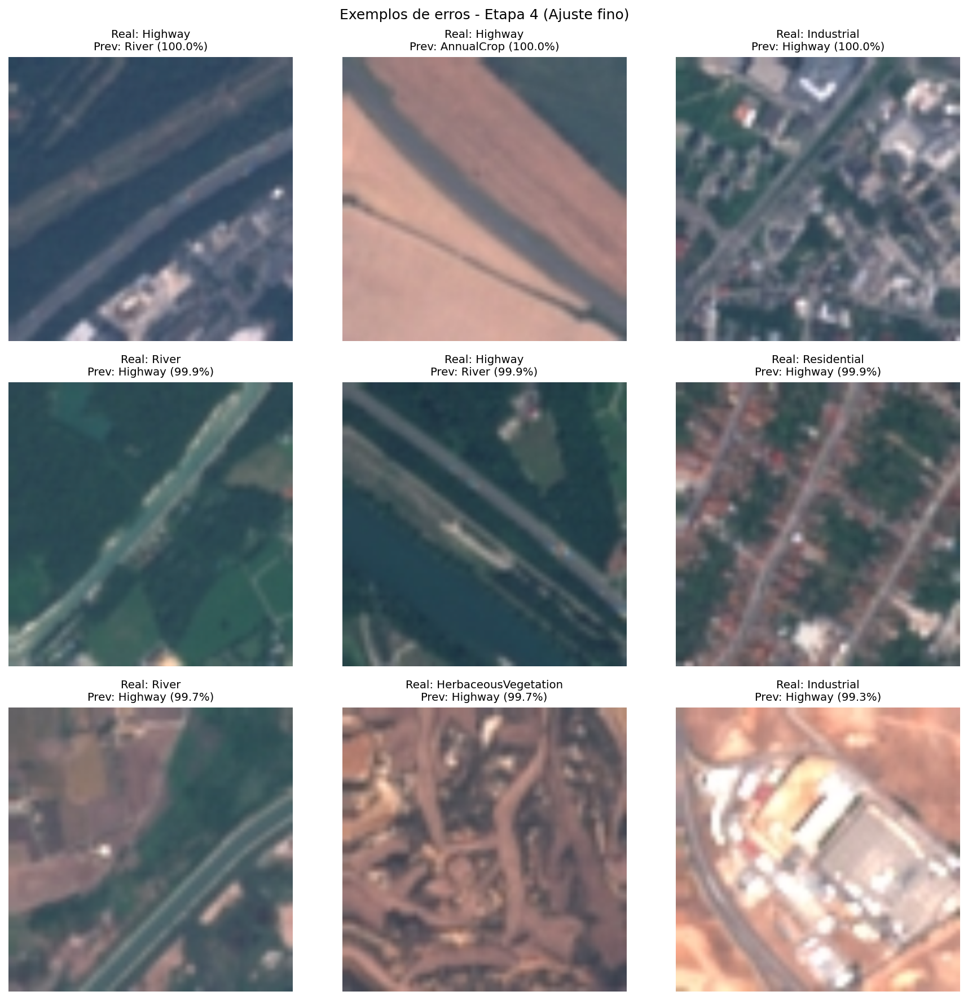

# Etapa 5 - Avaliacao dos resultados

Nesta etapa, os dois modelos treinados na Etapa 3 (apenas camada final `fc`) e na Etapa 4 (ajuste fino do bloco `layer4` + `fc`) foram avaliados sobre exatamente o mesmo conjunto de teste oficial da base EuroSAT RGB (4.050 imagens), utilizando apenas o pre-processamento deterministico da Etapa 2 (redimensionamento para 224 x 224 e normalizacao ImageNet, sem *data augmentation*).

## Arquivos

- `src/avaliacao.py`: carrega os dois checkpoints, executa a inferencia no conjunto de teste, calcula acuracia, F1 macro, metricas por classe e matrizes de confusao, e gera as figuras e o JSON oficial.
- `tests/test_avaliacao.py`: testes automatizados de avaliacao e validacao de classes sem download da base.
- `docs/resultados_avaliacao.json`: metricas completas, matrizes de confusao, hashes SHA-256 e lista dos principais erros de cada modelo.
- `docs/figuras/comparacao_metricas.png`: comparacao de Acuracia, F1 Macro e F1 por classe entre os dois experimentos.
- `docs/figuras/matrizes_confusao.png`: matrizes de confusao dos dois modelos lado a lado.
- `docs/figuras/exemplos_erros_inicial.png`: grade com exemplos de erros da Etapa 3.
- `docs/figuras/exemplos_erros_ajuste_fino.png`: grade com exemplos de erros da Etapa 4.

## Executar

Na raiz do projeto, com a base baixada em `data/eurosat/2750` e os checkpoints das Etapas 3 e 4 disponiveis em `outputs/treinamento_inicial/melhor_modelo.pth` e `outputs/ajuste_fino/melhor_modelo.pth`:

```bash
python -m src.avaliacao --num-workers 0
```

Para executar a suite completa de testes automatizados (sem baixar a base):

```bash
python -m unittest discover -s tests -v
```

## Configuracao da avaliacao

- Divisao fixa: `docs/data_split.json` (`sha256: b3817b3802fff966378fcc01f618fa495ec0a6bd6548824d671e94c0fb07ea9a`), com 4.050 imagens de teste (15% estratificados por classe).
- Checkpoint Etapa 3: melhor epoca 3 (`sha256: 85404adaa792c09300737d811b16b0f6a612a90ef7bb2fba4f39e5f3a91d14bf`).
- Checkpoint Etapa 4: melhor epoca 4 (`sha256: ae6dcc643e50e98e4e87b7da373d1e6a382e7d64b8a2dc5492ce9df39077ca50`).
- Ambiente: CPU no Windows, PyTorch `2.15.0+cpu`, lote de 64 imagens (`shuffle=False`), inferencia com `model.eval()` e `torch.no_grad()`.

## Comparacao global no conjunto de teste

| Experimento | Camadas treinadas | Acuracia (Teste) | F1 Macro (Teste) | Acertos | Erros |
| --- | --- | :---: | :---: | :---: | :---: |
| Etapa 3 — Treinamento inicial | `fc` | 92,91% | 92,62% | 3.763 / 4.050 | 287 |
| Etapa 4 — Ajuste fino | `layer4` + `fc` | **97,43%** | **97,34%** | **3.946 / 4.050** | **104** |
| **Diferenca (Etapa 4 vs. Etapa 3)** | — | **+4,52 p.p.** | **+4,72 p.p.** | **+183** | **-63,76%** |

Na comparacao pareada imagem a imagem sobre as 4.050 amostras de teste:
- **215 erros** cometidos na Etapa 3 foram corrigidos apos o ajuste fino;
- **72 imagens** permaneceram incorretas em ambos os modelos;
- **32 novos erros** surgiram na Etapa 4 em amostras que a Etapa 3 havia acertado (saldo liquido de 183 acertos adicionais).



## Desempenho por classe (F1-score no teste)

| Classe | Suporte | F1 Etapa 3 (`fc`) | F1 Etapa 4 (`layer4` + `fc`) | Ganho (p.p.) |
| --- | :---: | :---: | :---: | :---: |
| `AnnualCrop` | 450 | 94,47% | 97,65% | +3,18 |
| `Forest` | 450 | 95,69% | 98,89% | +3,20 |
| `HerbaceousVegetation` | 450 | 92,10% | 96,67% | +4,57 |
| `Highway` | 375 | 87,38% | 94,82% | +7,44 |
| `Industrial` | 375 | 94,34% | 97,84% | +3,49 |
| `Pasture` | 300 | 92,36% | 97,18% | +4,82 |
| `PermanentCrop` | 375 | 88,54% | 96,24% | +7,70 |
| `Residential` | 450 | 96,09% | 99,11% | +3,03 |
| `River` | 375 | 88,17% | 95,79% | +7,62 |
| `SeaLake` | 450 | 97,06% | 99,22% | +2,16 |



## Exemplos de erros





## Analise dos resultados

- **Generalizacao consistente sem sobreajuste:** os resultados no conjunto de teste acompanharam de perto os obtidos na validacao — na Etapa 3, 93,36% na validacao contra 92,91% no teste (-0,45 p.p.); na Etapa 4, 97,63% na validacao contra 97,43% no teste (-0,20 p.p.). Isso confirma que a selecao de checkpoints pela validacao preservou boa capacidade de generalizacao.
- **Ganho expressivo nas classes mais dificeis:** todas as 10 classes melhoraram com o ajuste fino, ultrapassando 94,8% de F1-score. Os maiores saltos ocorreram justamente nas categorias que exigem filtros mais especificos de textura e geometria aerea: `PermanentCrop` (+7,70 p.p.), `River` (+7,62 p.p.) e `Highway` (+7,44 p.p.).
- **Padroes de confusao nas matrizes:** na Etapa 3, os erros se concentravam fortemente em pares visualmente semelhantes vistos de cima — sobretudo `Highway` confundida com `River` (28 casos, estruturas lineares estreitas cortando vegetacao), `PermanentCrop` confundida com `HerbaceousVegetation` (20 casos) e `AnnualCrop` (12 casos), alem de `HerbaceousVegetation` confundida com `Forest` (14 casos). Apos o ajuste fino, essas confusoes cairam drasticamente (`Highway` -> `River` caiu para 11 casos; `PermanentCrop` -> `HerbaceousVegetation` caiu para 9; `HerbaceousVegetation` -> `Forest` caiu para 1).
- **Erros residuais de alta confianca:** os 104 erros restantes da Etapa 4 concentram-se majoritariamente em fronteiras ambiguas entre estruturas lineares (`Highway` vs. `River`: 17 confusoes nos dois sentidos; `Industrial` -> `Highway`: 9 casos, geralmente areas industriais cortadas por vias expressas) e entre tipos de vegetacao/cultivo (`PermanentCrop` vs. `HerbaceousVegetation` e `AnnualCrop`). Casos persistentes em ambos os modelos (como `Highway_891.jpg`, `Highway_1352.jpg` e `Highway_848.jpg`) costumam envolver recortes de baixa resolucao original (64x64) onde a classe alvo ocupa pequena porcao do quadro.